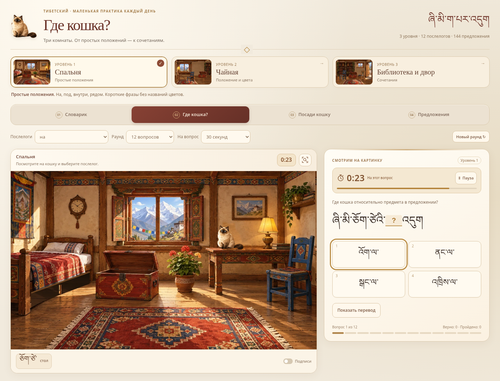
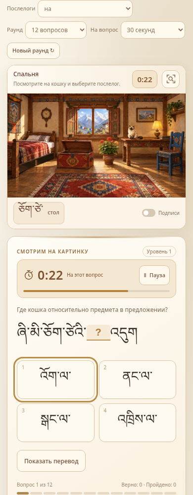

# Где кошка? — комнаты и тренировка на время

Браузерная игра для изучения тибетского языка. Версия 5.1 из архива `Gde_koshka_Rooms_v5_1_timer.zip`.

## Запуск

Скачайте репозиторий и откройте `index.html` в браузере. Иллюстрации и упражнения встроены в HTML; установка и сборка не требуются. `index.html` побайтно совпадает с исходным `Gde_koshka_Rooms_v5_1_timer.html`.

## Возможности

- Три комнаты, уровни сложности и четыре режима: «Где кошка?», «Посади кошку», «Предложения» и словарик.
- Тренировка без таймера или с лимитом 15, 30 либо 60 секунд на вопрос.
- Пауза, повторение ошибок и сохранение прогресса в браузере.
- Банк из 144 предложений, подписи, подсказки и приближение.

Для режима на время выберите комнату, режим и лимит в поле «На вопрос», затем нажмите «Новый раунд» и «Начать».

Подробная инструкция сохранена в [исходном README](Gde_koshka_Rooms_v5_1_timer_README.txt). Исходные HTML, JSON и два PNG-превью сохранены без изменений.

Шрифты подключаются через Google Fonts. Без интернета используется подходящий системный шрифт. Прогресс сохраняется отдельно для каждого адреса игры и браузера.

## Превью

